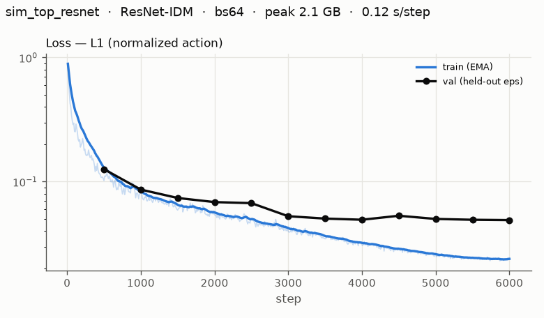
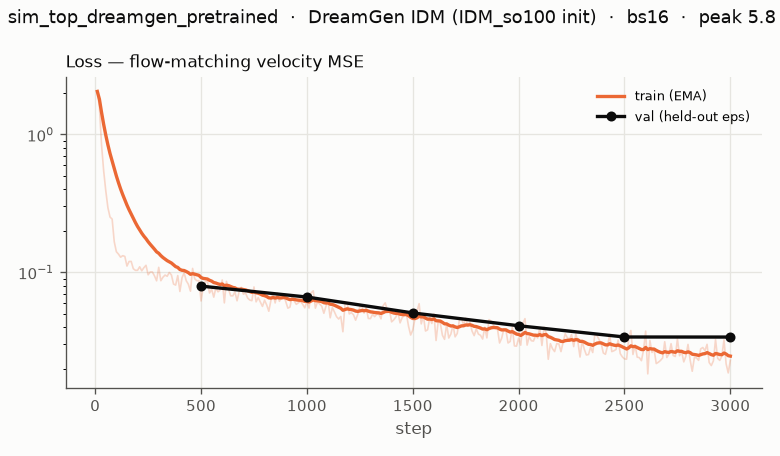
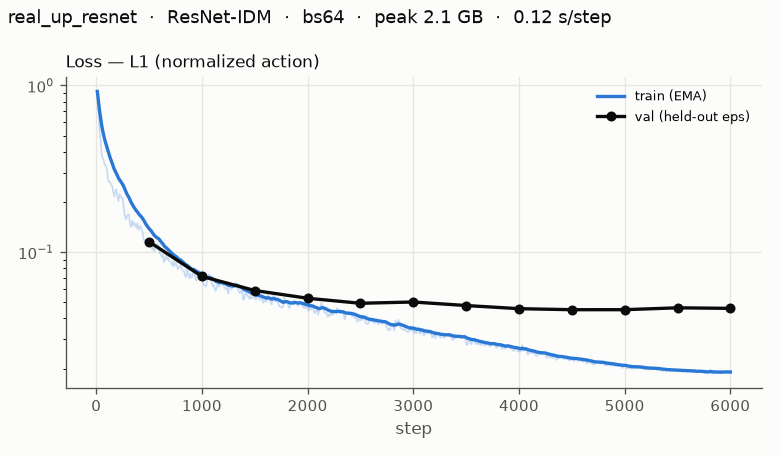
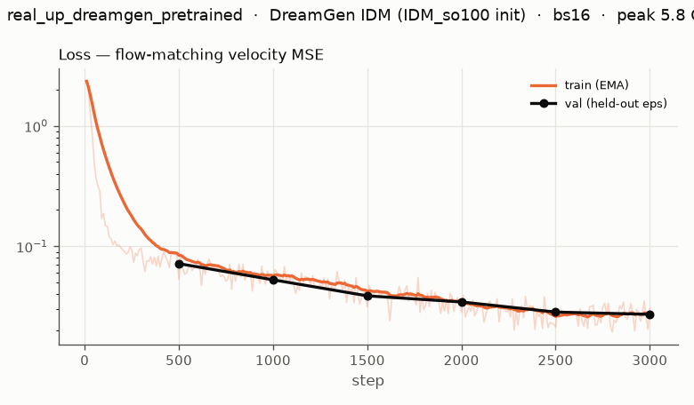

# IDM 실험 보고서 — SO101, top 뷰

DreamGen 계열 IDM을 **우리 GPU(RTX 4060 Ti 8GB)** 에서 ① 돌릴 수 있는지, ② 풀트레이닝할 수 있는지, ③ 학습 결과가 쓸 만한지 확인하고, 우리 프로젝트에 쓸 IDM을 고른 기록입니다.
우리 `care_world` 장면의 카메라는 top(헤드캠)과 wrist뿐이므로, 모든 실험은 **top 계열 카메라 하나**로 했습니다. 지표는 **RMSE** 를 씁니다.

- 실험 환경: RTX 4060 Ti 8GB · 드라이버 535 (CUDA 12.2) · RAM 14GB · torch 2.5.1+cu121
- 실험 일자: 2026-10-23 (모델, 메모리 실험) · 2026-10-26 (top 뷰 학습, 평가)

## 요약

| 질문 | 답 |
|---|---|
| 1. 내 GPU로 돌아가는가 | **예.** DreamGen IDM 추론은 bf16 기준 1.2GB, 학습은 5.3–5.8GB입니다. |
| 2. 풀트레이닝 가능한가 | **원본 레시피(fp32 + AdamW)로는 불가능**합니다. batch size 1에서도 OOM이 납니다. **grad checkpointing + 8-bit AdamW**를 쓰면 전체 파라미터(612M)를 학습할 수 있습니다(bs16, 6.3GB). |
| 3. 학습 결과가 괜찮은가 | **예.** held-out sim 에피소드에서 관절 RMSE 3.4°, MuJoCo 리플레이 시 엔드이펙터 오차 1.0cm입니다. 실제 SO101 영상에서도 nRMSE 3.3%, R² 0.985입니다. 다만 **카메라 배치나 관절 범위가 다른 영상(OOD)에서는 크게 실패**합니다. |
| 최종 선정 | **ResNet-IDM을 실물 top 뷰 데이터로 전체 학습합니다.** 모든 지표에서 1위이고 13분이면 학습이 끝납니다. DreamGen IDM은 코드만 남기고(`./install.sh --dreamgen`), 생성 영상 라벨링 비교에만 씁니다. 자세한 내용은 [최종 선정](#최종-선정) 참고. |

---

## 모델 후보

| 모델 이름 | 논문 사이트 | 비고 |
|---|---|---|
| **DreamGen IDM** (NVIDIA GR00T-Dreams) | [arXiv 2505.12705](https://arxiv.org/abs/2505.12705) · [GitHub](https://github.com/NVIDIA/GR00T-Dreams) | ✅ **실험함.** SigLIP2-Large 비전 인코더 + Self-Attn 4층 + Cross-Attn DiT 8층으로 된 flow-matching 액션 헤드입니다(637M). **SO100용 사전학습 체크포인트 [`seonghyeonye/IDM_so100`](https://huggingface.co/seonghyeonye/IDM_so100)가 공개**되어 있습니다(SO101과 관절 구성이 같음). 원본 의존성(tensorflow, ray, pytorch3d 등)이 무거워서 모델 코드는 원본을 그대로 import하고 데이터로더만 새로 작성했습니다. |
| **VPT IDM** (OpenAI) | [arXiv 2206.11795](https://arxiv.org/abs/2206.11795) | ✅ **실험함(ResNet-IDM).** Minecraft 영상에 키보드/마우스 라벨을 붙이는 데 쓴 비인과(non-causal) IDM입니다. 원본은 게임 액션 전용이라, 같은 아이디어(프레임 CNN 특징 + Transformer)로 SO101 관절 회귀용을 직접 구현했습니다(18.7M). |
| UniPi IDM | [arXiv 2302.00111](https://arxiv.org/abs/2302.00111) | 텍스트→영상 생성 후 소형 CNN IDM으로 액션을 추출합니다. 공식 코드가 없고, 구조가 ResNet-IDM과 사실상 같아서 별도로 실험하지 않았습니다. |
| Seer (Predictive IDM) | [arXiv 2412.15109](https://arxiv.org/abs/2412.15109) · [GitHub](https://github.com/OpenRobotLab/Seer) | 미래 프레임 예측과 IDM을 결합한 **정책**입니다(ICLR 2025 oral). 언어 조건과 대규모 사전학습(DROID)이 전제라서, "주어진 영상에 라벨을 붙이는" 순수 IDM 용도와 맞지 않아 제외했습니다. |
| AnyPos | [arXiv 2507.12768](https://arxiv.org/abs/2507.12768) | task-agnostic 랜덤 액션 데이터로 학습하는 IDM입니다(Arm-Decoupled Estimation). **양팔 로봇 전용 설계**라 제외했습니다. 데이터 수집 아이디어(ATARA, 사람 텔레옵 대비 30배 빠름)는 나중에 데이터를 늘릴 때 참고할 만합니다. |
| LAPA (Latent Action Pretraining) | [arXiv 2410.11758](https://arxiv.org/abs/2410.11758) | 실제 관절 값이 아니라 **잠재(latent) 액션**을 학습합니다. 로봇 관절 라벨을 얻으려면 별도 디코더가 필요해서 제외했습니다. |
| AVDC | [arXiv 2310.08576](https://arxiv.org/abs/2310.08576) | optical flow와 강체 가정으로 액션을 계산해서 학습되는 IDM이 없습니다. 그리퍼 개폐를 다루기 어려워서 제외했습니다. |

## 데이터셋

| 데이터셋 이름 | 저장소 | 사용 카메라 | 비고 |
|---|---|---|---|
| **so101-simstudio-lab01-pnp** (sim) | [HF: alexhegit/so101-simstudio-lab01-pnp](https://huggingface.co/datasets/alexhegit/so101-simstudio-lab01-pnp) | `camera_top` | SimStudio `simple_pick` 장면, 리더암 수집, LeRobot v3 포맷. 50 에피소드, 21,218 프레임, 20Hz, 액션 단위 rad(보고는 deg). |
| **svla_so101_pickplace** (실물) | [HF: lerobot/svla_so101_pickplace](https://huggingface.co/datasets/lerobot/svla_so101_pickplace) | `up` | **실제 SO101** 50 에피소드, 11,939 프레임, 30Hz. 액션 단위는 LeRobot 캘리브레이션 범위(-100~100, 그리퍼 0~100). sim 결론이 실물 영상에서도 유지되는지 확인하는 용도입니다. |
| leader-smoke-20261005 (우리 녹화) | `simstudio/datasets/leader-smoke-20261005` (로컬) | `camera_top` | 1 에피소드, 600 프레임, 320×240. **학습에 쓰지 않은 OOD 테스트 전용**입니다. 카메라 배치와 관절 범위가 위 sim 데이터와 다릅니다. |

- 위 데이터셋의 top 카메라는 우리 `care_world` 헤드캠과 위치가 다릅니다. 그래서 이 결과는 "top 계열 시점으로 IDM을 학습할 수 있는가"를 확인한 것이고, 우리 카메라에서의 성능은 우리 데이터로 다시 확인해야 합니다.
- 공통 전처리: 중앙 정사각 크롭 후 224×224로 캐시합니다(`src/prepare_data.py`). 학습 시 원본 so100 data config와 같이 Crop 0.95 → Resize → ColorJitter를 적용합니다.
- 50 에피소드를 seed 0으로 섞어 **45개 train / 5개 test(에피소드 13, 15, 24, 29, 39)** 로 나눴습니다. test 에피소드는 학습에 전혀 쓰지 않은 **held-out** 데이터입니다.

---

## GPU 메모리 실측 (풀트레이닝 가능 여부)

합성 배치로 8 step씩 실행해 측정했습니다(`src/probe_memory.py` → [`results/memory_probe.json`](results/memory_probe.json)). 카메라와 무관한 실험입니다.

| 설정 | 학습 파라미터 | batch | 결과 | peak 메모리 | s/step |
|---|---|---|---|---|---|
| A. 원본 레시피 (fp32 master + AdamW + bf16 autocast) | 612M | 16 / 4 / 1 | ❌ OOM | — | — |
| D. + grad checkpointing(SigLIP) | 612M | 4 | ❌ OOM | — | — |
| E. + single-embodiment 슬라이싱 | 480M | 4 | ❌ OOM | — | — |
| H. single-emb + 8-bit AdamW (ckpt 없음) | 480M | 8 | ❌ OOM | — | — |
| I. (참고) 비전 인코더 동결 = 부분학습, AdamW | 321M | 16 | ❌ OOM | — | — |
| **G3. grad ckpt + 8-bit AdamW** | **612M (원본과 동일)** | 16 | ✅ | 6.3 GB | 0.95 |
| **G. grad ckpt + single-emb + 8-bit AdamW** ← 본 학습 설정 | 480M | 16 | ✅ | 5.3 GB | 0.93 |
| G2. 위와 같음 | 480M | 32 | ✅ | 6.9 GB | 1.78 |
| ResNet-IDM (AdamW, fp32) | 18.7M | 64 | ✅ | 2.1 GB | 0.13 |

- 병목은 **옵티마이저 상태**입니다. fp32 AdamW 기준 파라미터당 16B이므로 612M × 16B ≈ 9.8GB가 되어, 배치와 무관하게 8GB를 넘습니다. 8-bit AdamW(파라미터당 ~10B)와 activation checkpointing을 함께 써야 들어갑니다.
- single-embodiment 슬라이싱: 원본 action encoder/decoder는 32개 embodiment용 가중치(`CategorySpecificLinear`)를 모두 들고 있지만 실제로는 so100 슬롯 하나만 씁니다. 그 슬롯만 남기면 **forward 결과는 같고** 파라미터가 132M 줄어듭니다.
- 원본 레시피와 다른 점은 8-bit 옵티마이저 양자화와 global batch(원본 IDM_so100은 32 GPU)뿐입니다. 학습률 1e-4, cosine, warmup 5%, betas (0.95, 0.999), bf16 autocast는 원본과 같습니다.

## 학습

| run | 모델 | 초기화 | steps × batch | 본 윈도우 | 시간 | peak 메모리 |
|---|---|---|---|---|---|---|
| `sim_top_resnet` | ResNet-IDM | ImageNet ResNet18 | 6000 × 64 | 384k (약 21 epoch) | 13분 | 2.1 GB |
| `sim_top_dreamgen_pretrained` | DreamGen IDM | IDM_so100 (전체 가중치) | 3000 × 16 | 48k (약 2.6 epoch) | 44분 | 5.8 GB |
| `real_up_resnet` | ResNet-IDM | ImageNet ResNet18 | 6000 × 64 | 384k (약 38 epoch) | 12분 | 2.1 GB |
| `real_up_dreamgen_pretrained` | DreamGen IDM | IDM_so100 | 3000 × 16 | 48k (약 4.8 epoch) | 44분 | 5.8 GB |

- 학습 윈도우 수: sim 18,336개, real 10,078개 (train 45 에피소드, 1프레임 간격).
- 1 step은 가중치를 한 번 업데이트한다는 뜻입니다. ResNet은 0.12초/step, DreamGen은 0.85초/step입니다.
- DreamGen은 정규화된 액션의 flow-matching velocity MSE로, ResNet은 정규화된 액션의 L1으로 학습했습니다. 손실 정의가 달라 loss 값끼리는 비교할 수 없고, 비교는 아래 평가 지표로 합니다.






---

## 검증 방법

1. **held-out 에피소드 분리**: 학습에 쓰지 않은 에피소드 5개(전체의 10%)를 처음부터 끝까지 라벨링합니다. 프레임이 아니라 에피소드 단위로 나눠서, 같은 에피소드의 인접 프레임이 train/test에 섞이지 않게 했습니다.
2. **DreamGen 사용 방식 그대로 라벨링**: 프레임 (t, t+16) → 16 액션, stride 16(`IDM_dump/dump_idm_actions.py`와 동일). flow-matching은 16 Euler step으로 샘플링하고 seed를 고정합니다.
3. **지표** (`src/evaluate.py`). 모델 출력(정규화 값)을 원래 단위로 되돌린 뒤 리더암 액션(`action`)과 비교합니다.
   - 관절별 **RMSE**: sim은 deg, real은 LeRobot raw 단위(-100~100). 큰 오차에 더 큰 벌점을 줘서, 라벨이 크게 튀는 구간을 잘 드러냅니다.
   - **nRMSE** = RMSE / (train 데이터 관절 범위) × 100%. 데이터셋끼리 비교하는 데 씁니다.
   - **R²**: 팔 5관절 평균. 1 − (오차 제곱합 / GT 분산)이라, 거의 움직이지 않는 관절은 작은 오차로도 낮게 나옵니다.
4. **기준선**
   - *평균 액션*: train 평균을 항상 출력합니다. 하한 기준입니다.
   - *상태 보간 오라클*: **GT 관절 상태** q<sub>t</sub>, q<sub>t+16</sub>를 선형 보간합니다. 생성 영상에는 이 정보가 없으므로 "포즈를 완벽하게 추정하는 모델이 선형 운동을 가정하면 얻는 수준"을 보여주는 참고값입니다.
5. **물리 검증 — MuJoCo 리플레이** (`src/sim_replay.py`): IDM 라벨을 SimStudio `simple_pick` 장면의 SO101에 position target으로 넣고(360Hz 물리, 20Hz 제어로 수집 설정과 동일), GT 액션을 넣었을 때와 **엔드이펙터(`wrist_site`) 궤적 차이(cm)** 를 비교합니다. 사전 검증으로 GT 액션 리플레이와 데이터에 기록된 EE 위치를 비교했고, 평균 0.10cm로 리플레이 자체가 기록을 정확히 재현합니다.
6. **OOD 테스트**: sim으로 학습한 모델을 우리 로컬 녹화(`leader-smoke-20261005`)에 그대로 적용했습니다.

## 검증 결과

### held-out 액션 정확도 — sim (단위 deg)

| 모델 | RMSE ↓ | nRMSE ↓ | R²(팔) ↑ | 그리퍼 RMSE ↓ | 추론 속도 | 추론 메모리 |
|---|---|---|---|---|---|---|
| 평균 액션 (하한) | 29.52 | — | — | — | — | — |
| 상태 보간 오라클 (GT 상태 사용) | 4.26 | — | — | — | — | — |
| **ResNet-IDM** | **3.43** | **3.14%** | **0.974** | **5.49** | 423 윈도우/s | 0.2 GB |
| DreamGen IDM (IDM_so100 init) | 5.01 | 4.67% | 0.917 | 6.31 | 37 윈도우/s | 1.2 GB (bf16) |

관절별 RMSE (deg)

| 모델 | shoulder_pan | shoulder_lift | elbow_flex | wrist_flex | wrist_roll | gripper |
|---|---|---|---|---|---|---|
| ResNet-IDM | 2.95 | 3.29 | 4.14 | 2.91 | 1.81 | 5.49 |
| DreamGen IDM | 4.14 | 4.80 | 6.55 | 4.48 | 3.76 | 6.31 |


검정선은 GT 액션, 주황선은 IDM 라벨, 세로 회색선은 16-step 청크 경계입니다.

### held-out 액션 정확도 — 실물 SO101 (raw 단위)

| 모델 | RMSE ↓ | nRMSE ↓ | R²(팔) ↑ | 그리퍼 RMSE ↓ | 추론 속도 | 추론 메모리 |
|---|---|---|---|---|---|---|
| 평균 액션 (하한) | 24.88 | — | — | — | — | — |
| 상태 보간 오라클 | 5.56 | — | — | — | — | — |
| **ResNet-IDM** | **2.50** | **3.30%** | **0.985** | **1.84** | 408 윈도우/s | 0.2 GB |
| DreamGen IDM (IDM_so100 init) | 3.44 | 4.66% | 0.972 | 2.82 | 33 윈도우/s | 1.2 GB (bf16) |


### MuJoCo 물리 리플레이 (sim test 5 에피소드, 엔드이펙터 오차)

| 모델 | 평균 | 중앙값 | p95 |
|---|---|---|---|
| (사전 검증) GT 액션 리플레이 vs 기록 | 0.10 cm | — | — |
| **ResNet-IDM** | **1.01 cm** | **0.73 cm** | **2.87 cm** |
| DreamGen IDM (IDM_so100 init) | 1.77 cm | 1.50 cm | 4.27 cm |

### OOD — 우리 로컬 녹화(leader-smoke, 학습 미사용), sim 학습 모델 적용

관절별 RMSE (deg). 기준선: 평균 액션 60.39, 상태 보간 오라클 7.75.

| 모델 | shoulder_pan | shoulder_lift | elbow_flex | wrist_flex | wrist_roll | gripper | 평균 |
|---|---|---|---|---|---|---|---|
| ResNet-IDM | 7.2 | 22.4 | 31.9 | 57.2 | 79.6 | 14.7 | 35.50 |
| DreamGen IDM | 6.2 | 27.0 | 28.4 | 58.1 | 78.0 | 14.5 | 35.37 |


### 해석

- **in-distribution에서는 성공했습니다.** 두 모델 모두 평균 액션 기준선보다 오차가 6–10배 작습니다. ResNet-IDM은 GT 관절 상태를 쓰는 보간 오라클(sim 4.26°, real 5.56)보다도 좋은데, 영상만 보고 시간축 가속/감속 패턴까지 학습했기 때문입니다. 리플레이 시 엔드이펙터 오차가 약 1cm여서 pick-and-place 데이터 증강용 라벨로 쓸 만한 수준입니다.
- **sim에서 본 경향이 실물 영상에서도 같습니다.** 실물 SO101에서도 nRMSE 3.3–4.7%, R² 0.97–0.99로 sim과 같은 순위, 비슷한 수준입니다.
- **ResNet-IDM이 모든 지표에서 앞섭니다.** sim과 real, 팔과 그리퍼, 리플레이까지 전부 ResNet이 좋고, 학습은 약 7배 빠르며 메모리는 2.7배 적습니다.
- **OOD에서는 두 모델 모두 실패합니다.** 아래 FAQ의 원인 분석처럼, 학습 범위 밖의 관절 값과 다른 카메라 배치가 원인입니다. 사전학습 대형 모델(DreamGen)도 해결하지 못했습니다. **IDM은 쓰려는 장면과 카메라에서 수집한 데이터로 학습해야 합니다.**

---

## 최종 선정

| 순위 | 모델 | 용도 | 근거 |
|---|---|---|---|
| **1 (주력)** | **ResNet-IDM** (VPT 계열 경량 IDM, `src/models.py: ResNetIDM`) | 우리 실물 top 뷰 데이터로 학습하고 pseudo-label을 만드는 기본 모델 | sim, real, 물리 리플레이 **모든 지표에서 1위**입니다(sim 3.43° / EE 1.0cm, real nRMSE 3.30% / R² 0.985). 학습 13분, 2.1GB, 추론 400 윈도우/s 이상이라 팀원 누구의 GPU에서도 데이터가 늘 때마다 바로 다시 학습할 수 있습니다. |
| 2 (비교용, 선택 설치) | **DreamGen IDM**, `IDM_so100`에서 풀 파인튜닝 (8-bit AdamW + grad ckpt + single-emb, bs16) | 생성 영상 라벨링 비교 실험 | 8GB에서 **풀트레이닝이 가능함을 확인**했습니다(5.3–5.8GB). 대규모 데이터로 사전학습된 SigLIP2 기반이라 **생성 영상의 artifact에는 더 강할 가능성**이 있습니다(미검증). 하지만 우리 데이터(약 45만 프레임)로는 1 epoch에 7시간 이상 걸리고, 데이터가 많을수록 사전학습의 이점은 줄어듭니다. 코드만 남기고 `./install.sh --dreamgen` 으로 설치할 때만 씁니다. |

**학습 데이터는 실물 데이터만 씁니다.** 비디오 생성 모델이 실물 데이터로만 학습하므로 생성 영상도 실물처럼 보입니다. IDM은 라벨을 붙일 영상과 같은 종류의 영상으로 학습해야 하고, sim 데이터는 카메라가 조금만 달라도 일반화되지 않았으므로(OOD 결과) 섞어도 도움이 되지 않습니다.

**다음 단계 (권장 순서)**

1. **우리 카메라 배치로 실물 데이터를 수집합니다.** 생성 모델이 쓸 top 카메라 시점에서 녹화하고, 관절 가동 범위를 골고루 포함하며, 수집 중에는 캘리브레이션을 바꾸지 않습니다. (계획: 100 trajectory × 2분 30초, 30fps ≈ 45만 프레임)
2. 데이터 규모에 맞게 `prepare_data.py`/`dataset.py` 를 mp4에서 바로 디코딩하도록 바꿉니다(지금 방식이면 캐시가 약 68GB).
3. 그 데이터로 ResNet-IDM을 학습하고(약 2–3 epoch, 30–45분), held-out 10 에피소드의 RMSE로 검증합니다. 실물만 쓰므로 MuJoCo 리플레이 대신 최종 확인은 실제 로봇 재생으로 합니다.
4. 생성 영상에 ResNet-IDM으로 라벨을 붙입니다(액션 없는 영상용 라벨링 스크립트 필요). 필요하면 DreamGen IDM과 한 번 비교하고, 큰 차이가 없으면 ResNet으로 확정합니다.

---

## FAQ

### held-out이 뭔가요?
학습에 쓰지 않고 따로 떼어 둔 평가용 데이터입니다. 학습 데이터로 평가하면 외운 결과가 섞이므로, 처음 보는 데이터로 평가해야 실제 성능을 알 수 있습니다. 여기서는 50 에피소드 중 5개(13, 15, 24, 29, 39번)이고, 우리 데이터(100개)에서는 `--n-test 10` 으로 10개를 뗍니다.

### 오차의 "각도"는 정규화된 값인가요?
모델은 관절별 학습 데이터 범위를 [-1, 1]로 맞춘 정규화 값을 출력합니다. 평가할 때 이를 **원래 단위로 되돌린 뒤** 비교합니다. sim 데이터셋의 액션은 rad 단위 관절 목표각이라 deg로 바꿔 보고했고, real 데이터셋은 처음부터 LeRobot 캘리브레이션 단위(-100~100)라 "raw"로 표기했습니다. 비교 대상은 팔로워 엔코더 값(`observation.state`)이 아니라 **리더암 명령값(`action`)** 입니다.

### step, epoch는 어느 정도인가요?
1 step = 가중치 1회 업데이트(batch 크기만큼의 윈도우를 봄)이고, 1 epoch = 학습 윈도우 전체를 한 번 보는 것입니다. 예를 들어 sim에서 DreamGen은 3000 step × batch 16 = 48k 윈도우로 학습 데이터(18,336 윈도우)를 약 2.6번 반복(2.6 epoch)했고, 0.85초/step이라 44분이 걸렸습니다. ResNet은 6000 step × batch 64 = 384k 윈도우(약 21 epoch)를 13분에 끝냅니다. 우리 데이터(약 45만 윈도우)는 ResNet 기준 1 epoch가 약 7k step입니다.

### 영상을 넣으면 알아서 잘라서 학습하나요? 긴 영상은요?
네. 영상 + 액션이 들어 있는 LeRobot 데이터셋을 `prepare_data.py` 로 캐시하면, `train.py` 가 에피소드마다 가능한 모든 시작점에서 (o<sub>t</sub>, o<sub>t+16</sub>) → a<sub>t:t+16</sub> 윈도우를 만듭니다. 라벨링(`evaluate.py` 의 `relabel_episode`)도 에피소드 전체를 겹치지 않는 16프레임 윈도우로 자동으로 자릅니다. 윈도우끼리 정보를 주고받지 않으므로 영상 길이와 무관하고 계산량만 비례해서 늘어납니다. 주의할 점은 세 가지입니다.
- **fps를 학습 데이터와 맞춰야 합니다.** 16프레임 간격의 실제 시간(30fps면 0.53초)이 달라지면 라벨 크기가 틀립니다.
- 끝부분 최대 16프레임에는 라벨이 붙지 않습니다.
- 청크 경계에서 값이 튈 수 있습니다. 윈도우를 반씩 겹쳐(stride 8) 평균하면 줄일 수 있습니다.

### 입력 카메라는 top과 wrist를 둘 다 넣어야 하나요?
아니요. DreamGen 원본 SO100 IDM도 카메라 하나(`video.webcam`)만 씁니다. 기준은 두 가지입니다. ① IDM 입력은 생성 모델이 만드는 뷰와 같아야 하고, ② 그 뷰에 팔 전체가 보여야 합니다. wrist 뷰는 팔이 안 보여서 단독으로는 어깨, 팔꿈치 각도를 알 수 없습니다. `care_world` 의 top 헤드캠은 팔 전체가 보이지만, 위에서 내려다보는 각도라 shoulder_lift, elbow_flex 같은 상하 관절의 깊이 정보가 약하고, shoulder_pan을 크게(±1.2rad) 돌리면 그리퍼가 화면 밖으로 나갑니다. wrist를 추가하면 이 약점을 보완할 수 있지만, 생성 모델이 두 뷰를 일관되게 동시에 만들어야 해서 난이도가 크게 올라갑니다. top 단독으로 먼저 가고, 필요하면 top vs top+wrist를 비교합니다.

### sim test에서 wrist_roll이 유독 나빠 보이는 이유는?
각도 오차 자체는 오히려 가장 작은 축입니다(ResNet RMSE 1.81°). 나빠 보이는 것은 R²(0.940) 때문입니다. pick-place에서 wrist_roll은 거의 움직이지 않아서(표준편차 8°, 프레임당 변화 0.2°) R²의 분모(GT 분산)가 작고, 작은 오차로도 R²가 떨어집니다. wrist_roll을 더 많이 쓰는 real 데이터(표준편차 17.8)에서는 R² 0.982로 정상입니다. 보조 요인으로, 그리퍼 자기 축 회전이라 224px 화면에서는 차이가 몇 픽셀밖에 안 납니다.

### 로컬 녹화(OOD)에서 오차가 큰 이유는?

| 관절 | 로컬 녹화 실제 값 | 학습 데이터 범위 | 모델 예측 | RMSE |
|---|---|---|---|---|
| wrist_roll | 84.8° (고정) | -17 ~ 45° | 약 5° | 79.6° |
| wrist_flex | -73 ~ 45° | 25 ~ 95° | 40 ~ 81° | 57.2° |

1. **관절 값이 학습 범위 밖입니다(주원인).** IDM은 학습 때 본 범위 밖으로 외삽하지 못하고 예측을 학습 범위 안으로 끌어옵니다. wrist_roll이 84°로 고정된 것은 실제 자세라기보다 리더암 캘리브레이션 offset 차이일 가능성이 있습니다.
2. **카메라 위치가 다릅니다.** 이름은 같은 `camera_top` 이지만 시점이 다르고, 로컬 녹화에서는 팔이 화면 가장자리에서 잘립니다.
3. **동작 분포가 다릅니다.** 관절을 하나씩 움직이는 테스트 동작이고, 그리퍼가 계속 닫혀 있습니다.
4. **해상도가 낮습니다** (320×240, 학습 데이터는 640×480).
5. **리더–팔로워 지연이 큽니다.** |action − state| 가 elbow 기준 6.8°(학습 데이터 2.5°)라, 화면에 보이는 자세와 액션 라벨의 차이가 영상만으로는 줄일 수 없는 오차가 됩니다.

### 캘리브레이션이 사전학습 데이터와 다르면 DreamGen 파인튜닝 성능이 떨어지나요?
조금은 손해지만 크지 않습니다. 정규화를 우리 데이터 기준으로 다시 계산하므로 offset, scale 차이는 대부분 흡수되고, 실제로 단위가 다른 sim(rad), real(-100~100) 모두 파인튜닝이 잘 됐습니다. 흡수되지 않는 것은 관절 방향(부호) 반전이나 일부 범위만 쓰는 경우이고, 이때는 사전학습의 출발점 이점이 줄어듭니다. 더 중요한 것은 **우리 데이터 안에서 캘리브레이션이 일관된 것**과 **정책을 돌릴 로봇의 캘리브레이션이 같은 것**입니다.

### 데이터가 많으면 DreamGen을 쓸 이유가 있나요?
사전학습의 이점은 데이터가 적을 때 큽니다. 우리 데이터는 약 45만 프레임으로 이 실험의 20배 이상이고, DreamGen은 1 epoch에 7시간 이상(ResNet은 약 15분) 걸립니다. 남은 확인 사항은 생성 영상의 artifact에 대한 강건성 하나입니다.

### sim 데이터를 IDM 학습에 섞어야 하나요?
아니요. 생성 모델이 실물 데이터로만 학습하므로 IDM도 실물 데이터로만 학습합니다. 대신 MuJoCo 리플레이 검증은 쓸 수 없으므로 held-out 실물 에피소드의 RMSE로 평가하고, 최종 확인은 실제 로봇 재생으로 합니다. 생성 영상의 번짐, 왜곡에 대비해 augmentation(blur, 색 변화, 압축 노이즈)을 강화하는 것을 고려합니다.

---

## 재현 방법

```bash
cd IDM
./install.sh --dreamgen                  # DreamGen run 까지 재현할 때. ResNet 만이면 ./install.sh
./experiments/run_experiments.sh         # 데이터 다운로드(top 카메라) -> 캐시 -> 학습 -> 평가 -> 그래프
# 선택: 로컬 녹화 OOD 평가, MuJoCo 리플레이까지
SMOKE_ROOT=<leader-smoke-20261005 경로> SCENE=<simstudio>/SO101/scenes/simple_pick/scene.xml ./experiments/run_experiments.sh
.venv/bin/python src/probe_memory.py     # GPU 메모리 실측 (DreamGen 설치 필요)
```

결과는 `runs/<run>/` 에 생깁니다. 이 문서에 쓰인 결과는 `results/` 에 복사해 두었습니다. 데이터(`data/`), 체크포인트, 학습된 가중치(`runs/*/model_bf16.pt`, DreamGen 1개당 약 1GB)는 Git에 포함하지 않습니다.
