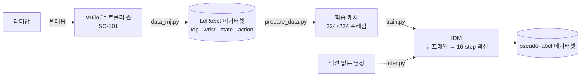

# 종합설계 — SO-101 약 전달 로봇팔

**MuJoCo 텔레옵으로 모은 시연 데이터와 IDM(Inverse Dynamics Model) pseudo-label로, 트롤리 위 약 전달 작업 정책 학습 데이터를 늘리는 프로젝트입니다.**


인하대학교 스마트모빌리티공학과 종합설계 (2026).

---

## 작업

SO-101 로봇팔이 트롤리 위에서 다음을 수행합니다.

1. 약 파우치 확인
2. 서랍에서 약 꺼내기
3. 컵에 붓고 젓기
4. 벨 누르기
5. 트레이·컵 건네기

## 왜 IDM인가

정책 학습에는 (영상, 액션) 쌍이 많이 필요하지만, 텔레옵 시연은 느리고 비쌉니다. 액션이 없는 영상(비디오 생성 모델 결과, 다른 녹화 등)에 IDM으로 액션 라벨을 붙이면 데이터를 싸게 늘릴 수 있습니다. 이 아이디어는 [DreamGen](https://arxiv.org/abs/2505.12705)을 따릅니다.

## 전체 흐름



## 결과 요약

top 카메라 한 대, held-out 에피소드 기준. 자세한 내용: [IDM/REPORT.md](IDM/REPORT.md)

| 평가 | 지표 | ResNet-IDM | DreamGen IDM |
|---|---|---:|---:|
| Sim held-out | 관절 RMSE (deg) | **3.43** | 5.01 |
| Sim held-out | R² (팔) | **0.974** | 0.917 |
| 실물 SO-101 held-out | nRMSE | **3.30 %** | 4.66 % |
| 실물 SO-101 held-out | R² (팔) | **0.985** | 0.972 |
| MuJoCo 물리 리플레이 | 엔드이펙터 오차 평균 | **1.01 cm** | — |
| 추론 | 처리량 | **423 윈도우/s** | 37 윈도우/s |

- **선정:** ResNet-IDM. 모든 지표에서 앞서고 13분이면 학습이 끝납니다.
- **8 GB GPU에서 612M 파라미터 풀트레이닝:** 원본 레시피(fp32 + AdamW)는 batch 1에서도 OOM이 나서, gradient checkpointing과 8-bit AdamW로 batch 16을 6.3 GB에 맞췄습니다.
- **한계:** 카메라 배치나 관절 범위가 학습 데이터와 다른 영상(OOD)에서는 크게 실패합니다.

## 폴더 구조

```text
jongseol/
├── simulation/                  # MuJoCo 씬, 리더암 텔레옵, 카메라 캘리브레이션, 데이터 취득
│   ├── models/                  #   씬(XML), SO-101 모델, 텍스처
│   ├── scripts/                 #   설치·udev 설정 스크립트
│   └── src/
│       ├── teleop/              #   리더/팔로워/MuJoCo 리더 구성, 관절 매핑, 환경 랜덤화
│       ├── camera-cali/         #   intrinsic·extrinsic 캘리브레이션
│       ├── tests/               #   씬 로딩, 리더암 연결, 랜덤화 확인
│       ├── teleop_mj.py         #   리더암 ↔ MuJoCo 텔레옵
│       └── data_mj.py           #   LeRobot 포맷 데이터 취득
├── IDM/                         # IDM 학습 · 평가 · 추론
│   ├── src/                     #   prepare_data · train · evaluate · infer · sim_replay
│   ├── experiments/             #   REPORT.md 실험 재현 스크립트
│   ├── results/                 #   REPORT.md 그림과 run별 지표
│   ├── README.md                #   사용법
│   └── REPORT.md                #   실험 보고서
└── datasets/                    # LeRobot 데이터셋 (git 제외)
```

각 하위 폴더의 `README.md`에 파일별 설명이 있습니다.

`simulation`과 `IDM`은 torch 버전이 달라서 가상환경을 따로 씁니다. 각 폴더의 명령은 그 폴더 안에서 실행합니다.

## 설치

```bash
cd simulation && ./scripts/auto_install.sh   # simulation/.venv (MuJoCo, LeRobot)
cd ../IDM && ./install.sh                     # IDM/.venv (torch)
# DreamGen IDM까지 쓰려면: ./install.sh --dreamgen
```

## 사용법

### 1. 데이터 취득 (`simulation/`)

리더암으로 시뮬레이션 속 SO-101을 조작해 녹화합니다. 결과는 `datasets/<이름>/`에 LeRobot 포맷으로 저장됩니다.

```bash
cd simulation
.venv/bin/python src/data_mj.py --task "작업 설명"
```

외부 데이터셋을 쓸 때도 `datasets/` 아래에 두면 됩니다 (LeRobot v3, 6차원 `action`/`observation.state`).

### 2. IDM 학습 (`IDM/`)

```bash
cd IDM
.venv/bin/python src/prepare_data.py --root ../datasets/<데이터셋> --camera observation.images.top --out data/cache/ours_top
.venv/bin/python src/train.py --model resnet --data data/cache/ours_top --out runs/ours_top_resnet \
  --n-test 10 --bs 64 --lr 3e-4 --wd 1e-4 --steps 6000 --eval-every 500 --save
.venv/bin/python src/evaluate.py --run runs/ours_top_resnet
```

### 3. 라벨 없는 영상 추론 (`IDM/`)

```bash
.venv/bin/python src/infer.py --run runs/ours_top_resnet --input <mp4 폴더 또는 ../datasets/<데이터셋>> \
  [--camera observation.images.top] --out <출력 폴더>
```

카메라 배치·fps·캘리브레이션을 학습 데이터와 맞춰야 합니다. 자세한 옵션: [IDM/README.md](IDM/README.md), [simulation/README.md](simulation/README.md)

## 개발 환경

RTX 4060 Ti 8 GB · CUDA 12.2 드라이버 · RAM 14 GB · torch 2.5.1+cu121

## 참고

1. [so101-simstudio](https://github.com/rocPAI-Forge/so101-simstudio)
2. [robosuite](https://github.com/ARISE-Initiative/robosuite)
3. [DreamGen](https://arxiv.org/abs/2505.12705) · [GR00T-Dreams](https://github.com/NVIDIA/GR00T-Dreams)

## 작성자

박건우 ([@PGW63](https://github.com/PGW63)) — 인하대학교 스마트모빌리티공학과
