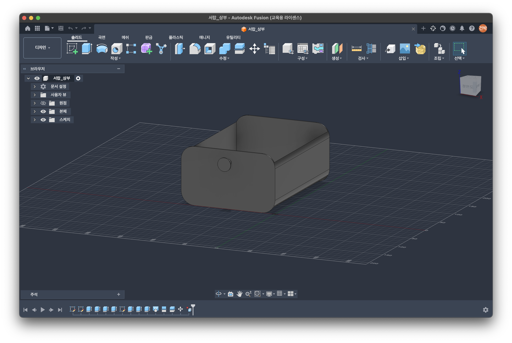
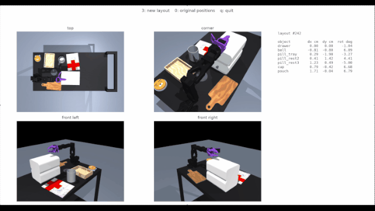
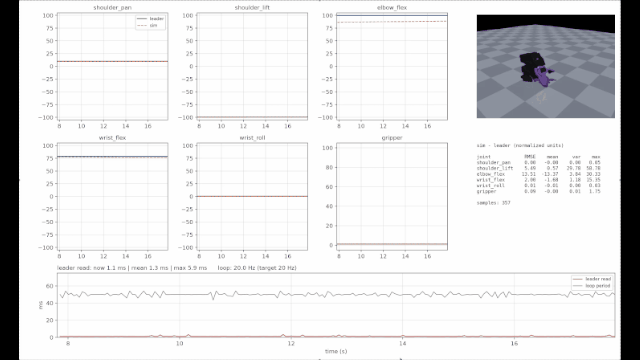

# 종합설계 

## 실제 로봇 연결
### 환경 설치
[자동 설치](scripts/auto_install.sh)

```
./scripts/auto_install.sh
```
## 캘리브레이션
### arm 정규화
```
.venv/bin/lerobot-calibrate \
  --teleop.type=so101_leader \
  --teleop.port=$HOME/dev/so101_leader_mj \
  --teleop.id=so101_leader_mj
```
> [!warning] udev 포트 다름 주의
> 
> 가이드에 나오는 udev이름이 다르니 알잘딱 필요


[가이드 영상](https://www.youtube.com/watch?v=vDS5eLKd9lM&t=5s)

[가이드 문서](https://wikidocs.net/328749)

### camera intrinsic calibration
모든 카메라의 포트 번호는 [config파일](src/camera-cali/)에서 각각 지정해주어야 한다.
- head
```
.venv/bin/python src/camera-cali/intrinsic_cali.py top --board 9x6 --square 0.025
```

- wrist
```
.venv/bin/python src/camera-cali/intrinsic_cali.py wrist --board 9x6 --square 0.025
```

### head cam to robot base extrinsic calibration 
모든 카메라의 포트 번호는 [config파일](src/camera-cali/)에서 각각 지정해주어야 한다.
```
.venv/bin/python src/camera-cali/headCam_to_Base.py --board 9x6 --square 0.025 --origin 0.30 0.20 --yaw 0
```
## 시뮬레이션 환경

### 모델링

1. mesh 생성 - Fusion, [MeshAI](https://www.meshy.ai/ko?utm_source=google&utm_medium=cpc&utm_campaign=23975044931&utm_content=204617268384&utm_term=meshai&gad_source=1&gad_campaignid=23975044931&gbraid=0AAAAApPWZYgakItlVSVd3BfGgmvEmJjc3&gclid=CjwKCAjwrbfWBhAeEiwAc2e6Pp-0cezlca5-rMgsngFRUg6QcYgm8J7gPp_p_0KEDPlcKeWrKwqnaRoCmjoQAvD_BwE)
2. texture 입히기 - Blender or MuJoCo
3. Joint 생성(서랍같은 녀석들) - MuJoCo


### 환경 배치 Randomization
- 물건들의 Transformation
- 조명변화
- 바닥 Textrue
```
.venv/bin/python src/tests/randomize_env.py
```



### 연결 확인
```
.venv/bin/python src/tests/check_connection_with_leader.py
```



### 데이터 취득
> [!NOTE] 기본 instructions
>
> Check the medication pouch. Then, take the medication from the drawer and place it on the left tray. Place the ointment from the top of the drawer on the left tray, followed by the pill bottle. Put the eye-drop bottle in front of the drawer into the cup. Pour the medicine from the bottle on the right tray into the cup, then stir the contents. Press the bell, then hand over the left tray, followed by the cup.

시뮬레이션 키기 & 텔레옵 연결
```
.venv/bin/python   src/teleop_mj.py --headless
```

데이터 취득
```
.venv/bin/python src/data_mj.py --task "작업 설명"
```
## 구현 reference
1. [so101-simstudio](https://github.com/rocPAI-Forge/so101-simstudio)
2. [robo-suite](https://github.com/ARISE-Initiative/robosuite)


# TODO
- [ ] wrist view, top view calibration하기
- [ ] top view to robot case extrinsic calibration 하기
- [ ] calibration값 무조코에 적용하기
- [ ] replay 구현해서, 실제 궤적 데이터와 얼마나 차이 나는지 확인하기
- [ ] 약 및 스틱 모델링하기
- [ ] 약 및 스틱 무조코 환경에 넣기
- [ ] 약 및 스틱 위치 랜덤화하기
- [ ] 시나리오에 맞게 데이터 취득하기

---

```
.venv/bin/python src/data_mj.py --task "Check the medication pouch. Then, take the medication from the drawer and place it on the left tray. Place the ointment from the top of the drawer on the left tray, followed by the pill bottle. Put the eye-drop bottle in front of the drawer into the cup. Pour the medicine from the bottle on the right tray into the cup, then stir the contents. Press the bell, then hand over the left tray, followed by the cup."
```