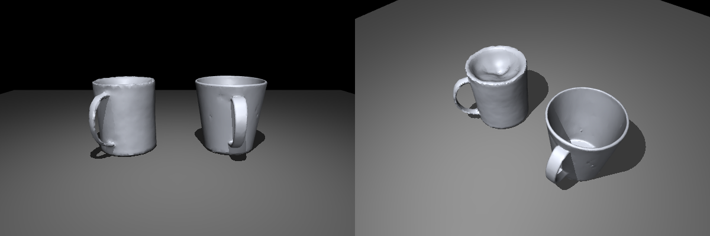

# Image → 3D 모델링 (third-party)

사진 한 장으로 물체 mesh 를 만들어 MuJoCo 씬에 넣는 방법입니다. 약병, 연고, 안약, 스틱처럼 Fusion 으로 직접 그리기 귀찮은 작은 물체용입니다. 시뮬레이션 전체 설명은 [README](README.md)를 보세요.

> [!NOTE] 아래 명령은 모두 `simulation/` 폴더에서 실행합니다. 모델 코드와 생성 결과는 `simulation/third_party/` 에 두고 git 에는 올리지 않습니다 (`.gitignore` 에 등록됨). 우리 쪽 코드는 [src/image_to_3d/](src/image_to_3d/) 에 있습니다.

## 모델 선택: TripoSG

RTX 4060 Ti **8GB** 기준입니다.

| | [TripoSG](https://github.com/VAST-AI-Research/TripoSG) | [Stable Fast 3D](https://github.com/Stability-AI/stable-fast-3d) (SF3D) | 그 외 |
|---|---|---|---|
| 8GB 에서 | 됨 (offload 적용, GPU 최대 약 3.2GB, 직접 확인) | 됨 (약 6.2GB, 직접 확인) | TRELLIS.2 는 공식 24GB, Hunyuan3D 는 아래 라이선스 문제 |
| 형상 | **매끈함**, 컵 안쪽 깊이·손잡이·얇은 벽까지 나옴 | 표면이 울퉁불퉁, 컵 안쪽이 얕게 메워짐 | |
| 텍스처 | 없음 (모양만) | 있음 | |
| 속도 | 약 80초 | 약 1.5초 | |
| 라이선스 | MIT (배경 제거용 RMBG-1.4 는 비상업 라이선스) | Stability AI Community (연 매출 100만 달러 미만 무료, HF 동의 필요) | Hunyuan3D: **대한민국·EU·영국은 적용 지역에서 제외** |



같은 컵 사진(`blueCup.jpeg`)으로 만든 결과입니다. 왼쪽 SF3D, 오른쪽 TripoSG.

→ **형상은 TripoSG 로 만듭니다.** 우리 물체는 대부분 단색이라 텍스처가 없어도 MuJoCo `material` 의 `rgba` 로 색만 주면 됩니다. 라벨처럼 무늬가 꼭 필요한 물체만 SF3D 를 씁니다 ([아래](#sf3d-텍스처가-필요할-때)).

## 설치 (TripoSG)

다른 가상환경과 섞이지 않게 `.venv-triposg` 를 따로 만듭니다.

```
git clone https://github.com/VAST-AI-Research/TripoSG.git third_party/TripoSG
uv venv --python 3.10 .venv-triposg

# torch: 드라이버 535 는 CUDA 12.2 까지라서 cu121 휠 (torch 2.5.1)
uv pip install --python .venv-triposg/bin/python torch torchvision --index-url https://download.pytorch.org/whl/cu121

# 나머지 의존성. diso 는 CUDA 확장이라 아래에서 따로 빌드
grep -v '^diso' third_party/TripoSG/requirements.txt > /tmp/req_triposg.txt
uv pip install --python .venv-triposg/bin/python -r /tmp/req_triposg.txt
# 최신 diffusers 는 torch 2.6 이상을 요구한다 (torch.accelerator). TripoSG 공개 시점(2025.04) 버전으로 고정
uv pip install --python .venv-triposg/bin/python diffusers==0.33.1 transformers==4.51.3 peft==0.15.2

uv pip install --python .venv-triposg/bin/python setuptools wheel ninja
TORCH_CUDA_ARCH_LIST="8.9" uv pip install --python .venv-triposg/bin/python --no-build-isolation diso
```
가중치(약 8GB: TripoSG 7.5GB + RMBG-1.4 0.8GB)는 처음 실행할 때 `third_party/TripoSG/pretrained_weights/` 로 자동으로 받습니다. 로그인 필요 없습니다.

> [!warning] 원본 스크립트를 그대로 쓰면 안 되는 이유
>
> - `python -m scripts.inference_triposg` 는 ROS Humble 의 `PYTHONPATH` 에 있는 `scripts` 패키지를 먼저 잡아서 `No module named 'catkin_pkg'` 로 죽습니다.
> - 원본은 모든 모델을 GPU 에 올린 채 마지막 mesh 추출(505³ 격자)까지 가서 8GB 를 넘깁니다 (`CUDA error: an illegal memory access`).
>
> 그래서 [run_triposg.py](src/image_to_3d/run_triposg.py) 로 돌립니다: 배경 제거 모델은 쓰고 바로 내리고, 나머지는 CPU offload 로 필요한 것만 GPU 에 올립니다. 실행할 때는 `env -u PYTHONPATH` 로 ROS 경로를 뺍니다.

## 사용법

### 1. 사진 찍기
- 물체 **하나만**, 화면 가운데에 꽉 차게. 배경은 자동으로 지워지지만 단색 배경이 잘 됩니다.
- 약간 위(10~30°)에서 찍으면 윗면 모양까지 잘 나옵니다.
- 반사가 심한 물체(유리병, 금속)는 형상이 잘 깨집니다. 결과가 이상하면 각도를 바꿔 다시 찍습니다.
- 원본은 `assets/sf3d_inputs/<이름>.jpeg` 에 모아 둡니다.

### 2. mesh 생성
```
env -u PYTHONPATH .venv-triposg/bin/python src/image_to_3d/run_triposg.py assets/sf3d_inputs/blueCup.jpeg
```
- 결과: `third_party/triposg_out/blueCup.glb`
- `--faces 10000`: 면 개수 상한. 시뮬레이션용이면 5000~10000 이면 충분합니다.
- `--octree-depth 8`: 추출 해상도를 낮춰 메모리와 시간을 아낍니다 (기본 9).
- `--seed`: 결과가 마음에 안 들면 시드를 바꿔 다시 뽑아 봅니다.

### 3. MuJoCo 형식으로 변환
[glb_to_mj.py](src/image_to_3d/glb_to_mj.py) 가 씬 규약에 맞게 바꿉니다. **높이는 자로 잰 실측값(cm)** 을 넣습니다.
```
.venv-triposg/bin/python src/image_to_3d/glb_to_mj.py third_party/triposg_out/blueCup.glb blue_cup 9.5
```
→ `models/mj/blue_cup.obj` (텍스처가 있는 GLB 면 `models/textures/blue_cup.png` 도)

| | 생성 GLB | 우리 씬 ([scene_trolley.xml](models/scene/scene_trolley.xml)) |
|---|---|---|
| 위쪽 | 모델마다 다름 (SF3D 는 카메라 각도만큼 기울어짐, TripoSG 는 옆으로 누워 나오기도 함) | +Z |
| 단위 | 정규화(약 ±1) | cm, XML 에서 `scale="0.01 0.01 0.01"` |
| 원점 | 대략 중심 | 바닥면 중심 |

- **세우기**: 축을 가정하지 않고, convex hull 의 평면 중 mesh 면이 가장 넓게 붙어 있는 평면(= 실제로 바닥에 닿는 면)을 찾아 아래로 돌립니다. 컵 입구처럼 테두리만 닿는 평면은 붙은 면적이 작아서 걸러집니다. 바닥이 평평하지 않은 물체(공, 눕힌 튜브)는 잘못 세울 수 있으니 확인합니다.
- 출력되는 x, y 크기가 실물과 많이 다르면 사진 문제이니 다시 생성합니다. 앞뒤 방향(yaw)은 XML 의 `quat`/`euler` 로 맞춥니다.

### 4. 씬에 넣기
[scene_trolley.xml](models/scene/scene_trolley.xml) 의 기존 물체와 같은 방식입니다. **visual 은 생성 mesh, 충돌은 primitive** 로 따로 잡습니다. MuJoCo 는 mesh 충돌을 convex hull 로 처리하므로, 생성 mesh 를 그대로 충돌에 쓰면 컵 안쪽 같은 오목한 부분이 메워집니다.

```xml
<asset>
  <!-- 텍스처 없이 색만: 사진 보고 rgba 를 맞춘다 -->
  <material name="mat_pill_bottle" rgba="0.92 0.55 0.20 1" specular="0.2" shininess="0.1"/>
  <mesh name="pill_bottle" file="pill_bottle.obj" scale="0.01 0.01 0.01"/>
</asset>

<worldbody>
  <body name="pill_bottle" pos="0.30 0.10 0.7300">
    <freejoint name="pill_bottle_free"/>
    <geom class="vis" mesh="pill_bottle" material="mat_pill_bottle"/>
    <!-- 충돌: 실측 반지름/높이로 원통 하나 (size = 반지름, 반높이) -->
    <geom class="col" name="pill_bottle_col" type="cylinder" pos="0 0 0.0425" size="0.018 0.0425" density="500"/>
  </body>
</worldbody>
```
- 컵처럼 안이 빈 물체는 기존 `cup` 처럼 바닥 원통 + 벽 박스 여러 개로 충돌을 잡습니다.
- 질량은 `density` 로 맞춥니다. 실물 무게를 재서 `무게 / primitive 부피` 로 넣으면 됩니다.
- 랜덤 배치에 넣으려면 [automatic.json](models/automatic.json) 의 `objects` 에 body 이름을 추가합니다.
- 확인: `.venv/bin/python src/tests/run_scene.py` 로 띄워서 뷰어에서 group 3(충돌)을 켜고 visual 과 겹치는지 봅니다.

## SF3D: 텍스처가 필요할 때

라벨이나 무늬를 꼭 살려야 하는 물체만 씁니다. 형상은 TripoSG 보다 떨어집니다. 모델이 gated 라서 [stabilityai/stable-fast-3d](https://huggingface.co/stabilityai/stable-fast-3d) 에서 라이선스 동의 후 로그인해야 합니다 (`uvx --from huggingface_hub hf auth login`, 토큰은 https://huggingface.co/settings/tokens 에서 Read 로 생성).

```
git clone https://github.com/Stability-AI/stable-fast-3d.git third_party/stable-fast-3d
uv venv --python 3.10 .venv-sf3d
uv pip install --python .venv-sf3d/bin/python torch torchvision --index-url https://download.pytorch.org/whl/cu121
cd third_party/stable-fast-3d
uv pip install --python ../../.venv-sf3d/bin/python -U setuptools==69.5.1 wheel
TORCH_CUDA_ARCH_LIST="8.9" uv pip install --python ../../.venv-sf3d/bin/python --no-build-isolation -r requirements.txt
cd ../..

.venv-sf3d/bin/python third_party/stable-fast-3d/run.py assets/sf3d_inputs/blueCup.jpeg \
  --output-dir third_party/sf3d_out/blueCup --texture-resolution 1024 \
  --remesh_option triangle --target_vertex_count 5000
# -> third_party/sf3d_out/blueCup/0/mesh.glb, 변환은 위 3번과 같음 (텍스처 PNG 도 같이 나옴)
```
실행 중 나오는 `TensorRT ... libnvinfer.so.10` EP Error 는 배경 제거가 CPU 로 넘어갔다는 뜻이라 무시해도 됩니다.

## 체크리스트 (물체 하나당)
- [ ] 사진 찍기 → `assets/sf3d_inputs/`
- [ ] `run_triposg.py` 로 GLB 생성
- [ ] `glb_to_mj.py` 로 OBJ 변환 (실측 높이)
- [ ] XML 에 visual mesh + 색 + 충돌 primitive 추가
- [ ] density 로 질량 맞추기
- [ ] `automatic.json` 에 랜덤화 범위 추가
- [ ] 뷰어에서 충돌 / 그립 확인
